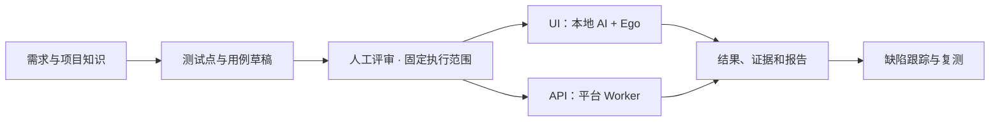

# AITestHub

**从需求、用例到执行、证据和复测，把 AI 测试接进团队工作流。**

AITestHub 是一个开源的 AI 辅助测试协作平台。AI 可以根据需求和项目知识设计用例，在本地操作浏览器，或把接口文档整理成可执行的回归资产；平台负责项目权限、人工评审、版本、运行记录和报告。

[配套 Skills](#skills) · [开始使用](#get-started) · [本地部署与开发](#development) · [贡献与许可](#contributing)

## 一次测试怎么走



- **设计有依据：** 用例从需求、原型和项目规则出发。UI 用例可以固定业务目标与预期，不必预先写死每一步点击。
- **执行有范围：** UI 在用户本地的 AI 宿主与 Ego 中执行，平台不远程启动浏览器；常规 API 回归由平台 Worker 执行。
- **结论能回查：** 运行关联固定范围和用例版本；原始结果、证据和人工结论分别保留，复测可以关联新运行而不覆盖旧记录。

<a id="skills"></a>

## 配套 Skills

按任务选用，不必一次装齐。**Skill 提供工作方法，官方 MCP 提供平台操作入口，平台仍负责权限与审批。**

| 你想做什么                             | Skill 仓库                                                                   | 从哪里开始                                                                                                                                                                                                 |
| -------------------------------------- | ---------------------------------------------------------------------------- | ---------------------------------------------------------------------------------------------------------------------------------------------------------------------------------------------------------- |
| 把需求、原型和规则变成测试点与待审用例 | [Case Design](https://github.com/99Like-wjj/AITestHub-CaseDesign-Skill)      | [ath-case-design](https://github.com/99Like-wjj/AITestHub-CaseDesign-Skill/blob/main/skills/ath-case-design/SKILL.md)：提供目标项目、需求版本和 UI/API 范围，先生成草稿，再到平台评审。                    |
| 整理项目地图、通用规则和知识条目       | [Project Knowledge](https://github.com/99Like-wjj/AITestHub-Knowledge-Skill) | [ath-project-knowledge](https://github.com/99Like-wjj/AITestHub-Knowledge-Skill/blob/main/skills/ath-project-knowledge/SKILL.md)：指定项目与资料范围，按需读取；有两份独立资料时先比较，再在平台处理差异。 |
| 在本地执行已批准的 Web UI 测试         | [Ego UI Test](https://github.com/99Like-wjj/AITestHub-EgoTest-Skill)         | [ath-web-execute](https://github.com/99Like-wjj/AITestHub-EgoTest-Skill/blob/main/skills/ath-web-execute/SKILL.md)：准备本地 AI、Ego 与宿主接入，领取已批准的 UI 范围，再回传结果和证据。                  |
| 把接口文档变成平台原生回归用例         | [API Test](https://github.com/99Like-wjj/AITestHub-ApiTest-Skill)            | [ath-api-regression](https://github.com/99Like-wjj/AITestHub-ApiTest-Skill/blob/main/skills/ath-api-regression/SKILL.md)：输入接口 Markdown 和目标场景，生成请求链、变量和断言；调试与执行在平台进行。     |

> 仓库里的 `SKILL.md` 是使用入口，不等于安装完毕。外部 AI 宿主的 Skill 加载方式、构建或打包要求，以各仓库 README 和宿主适配说明为准。Ego UI Test 还需要本地浏览器能力及受信宿主端口。

<a id="get-started"></a>

## 开始使用

**已有 AITestHub 实例？** 从一个项目、一份需求和一条测试流程开始：

1. 在平台确认项目、需求版本、测试环境与权限。第一次体验建议用合成项目和测试账号。
2. 使用平台 AI，或让支持 MCP 的本地 AI 宿主连接该实例的官方 MCP。按上表选择 Skill，先生成一条用例草稿，在平台核对并评审。
3. 通过已批准的 UI 计划发起本地执行，或在平台执行配置好的 API 用例。最后从报告回查预期、实际结果和证据。

**可以这样对 AI 说：**「用 `ath-case-design`，根据这个项目的需求 V1，为登录流程设计 UI 测试点和用例草稿。先给我审阅，不执行。」

**想自己搭建？** 跟随下方 Docker 配置和源码构建说明。不要把已有实例的凭据或真实测试资料填进仓库。

<a id="development"></a>

## 本地部署与开发

- **本地实例：** 从 [本地 Docker 配置](deploy/local/README.md) 开始。环境设置、数据库与对象存储凭据使用库外私有配置。已有实例升级前先备份，并按目标版本核对升级方案。
- **部署与运维：** 参考 [GitHub Actions 与发布流程](docs/development/ci-cd.md)、[部署配置边界](deploy/personal-cloud/CONFIGURATION.md)和[运行工具分类](scripts/README.md)。源码更新不会自动更新已部署实例。

### 从源码构建

使用 [package.json](package.json) 锁定的 Node.js、pnpm 版本与提交的锁文件：

```sh
pnpm install --frozen-lockfile
pnpm typecheck
pnpm build
pnpm format:check
```

[独立 MCP 客户端](tooling/local-client/README.md)使用自己的锁文件：

```sh
cd tooling/local-client
pnpm --ignore-workspace install --frozen-lockfile
pnpm --ignore-workspace build
```

### 代码位置

- `apps/`：Web、HTTP API、官方 MCP 入口及 AI/API Workers。
- `packages/`：共享契约、业务服务、持久化、存储和模型适配。
- `tooling/local-client/`：可独立构建的 MCP 客户端与契约。
- `deploy/`：本地 Docker 配置、可移植模板和发布工具。

<a id="contributing"></a>

## 贡献与许可

修改前请阅读 [贡献指南](CONTRIBUTING.md)、[AGENTS.md](AGENTS.md) 与 [工程规范](docs/development/README.md)。提交前运行 `pnpm quality:check`，并对照[审查清单](docs/development/review-checklist.md)。

公开仓库包含源码和可移植配置。私有测试套件、运行证据、真实实例配置与凭据不随源码分发。详见[源码发布范围](SOURCE_PUBLICATION.md)和[安全说明](SECURITY.md)。

[MIT License](LICENSE)
